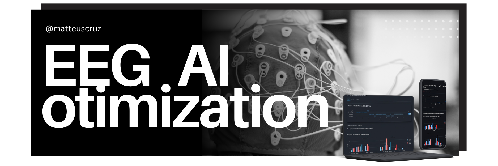

## Hi, I'm Mateus Cruz

AI Researcher | Software Developer | Ph.D. Candidate in Electrical Engineering | Msc. in Telecommunication Engineering

I'm a Ph.D. candidate with experience in two research institutions, Unifei and Inatel. Currently, I am pursuing a Ph.D. in Electrical Engineering at the Federal University of Itajubá (UNIFEI), where my research focuses on Neural Architecture Search (NAS) for EEG-based deep learning models targeting resource-constrained embedded devices. My work investigates hardware-aware optimization techniques for designing efficient neural networks capable of performing intelligent signal analysis in low-power edge computing environments.

During my time at the Instituto Nacional de Telecomunicações (INATEL), I conducted research on decentralized learning approaches based on Federated Learning and Blockchain, exploring distributed architectures for privacy-preserving and collaborative AI systems. Additionally, during my Master’s research, I investigated IoT-based solutions for agriculture using LoRa communication technologies, focusing on low-power wireless networks for Computer Vision and Machine Learning models, edge-enabled sensing, and smart monitoring systems for agricultural applications.

My background spans **Engeneering, Computer Science, Data Science and Artificial Intelligence System**, providing a multidisciplinary foundation for developing AI-driven solutions at the intersection of **Edge AI, IoT, and distributed intelligence**.

## Main Projects

## 🛠️ Technology Stack

<table>
  <tr>
    <td align="center" width="180">
      <strong>AI & Agents</strong>
    </td>
    <td>
      
      
      
      
      
      
      
      
      
      
      
      
      
      
    </td>
  </tr>
  <tr>
    <td align="center">
      <strong>Backend & Cloud</strong>
    </td>
    <td>
      <img src="
